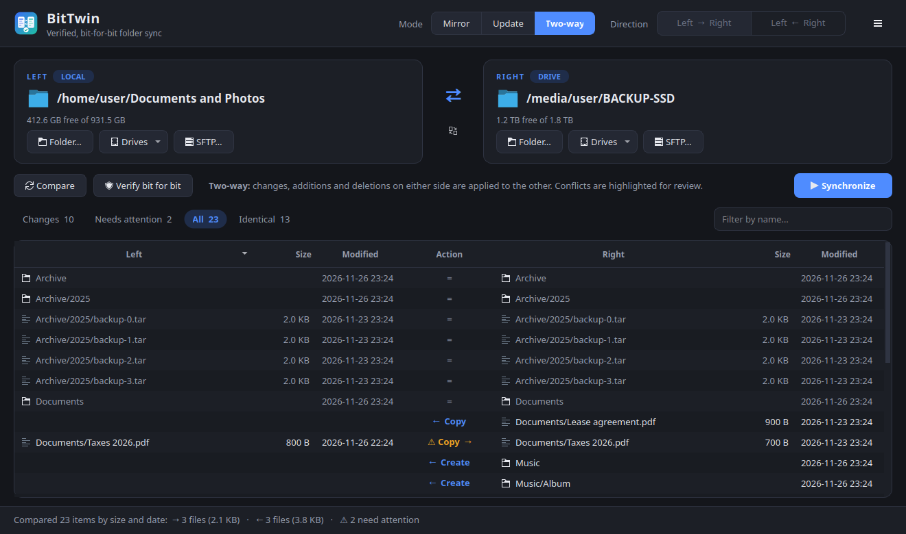
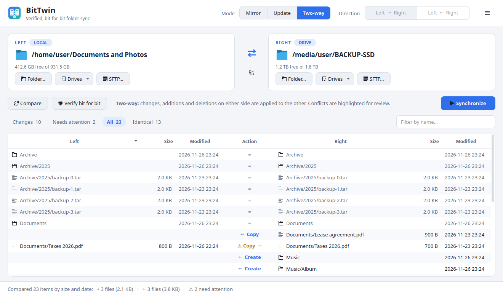

<div align="center">


# BitTwin

**Verified, bit-for-bit folder synchronization for Linux.**

Sync folders between internal disks, USB drives and SFTP servers, and know that
every byte arrived exactly as it left.


-41cd52)




</div>

---

## Why BitTwin?

Most sync tools trust that a write succeeded. BitTwin doesn't. **Every file it copies goes
through the same checks before it's allowed to replace anything:**

1. The source is streamed into a **hidden temporary file** next to the destination,
   and its **SHA-256** is calculated on the way.
2. The temp file is **flushed and `fsync`ed** so the data is physically on the drive,
   then dropped from the Linux page cache.
3. The copy is **read back from the drive** and hashed again. Both hashes must match
   **bit for bit**.
4. *(on by default)* The **source is read a second time**, also bypassing the cache,
   to catch failing drives and flaky USB cables that return different data on each read.
5. Only then is the file's date and permissions applied and the temp file
   **atomically renamed** into place.

If any check fails, the temp file is thrown away and the copy is retried. If it keeps
failing, the existing destination file is **left untouched** and the problem is reported.
A power cut or unplugged drive in the middle of a sync can never leave a half-written file
in place of a good one.

**BitTwin is fully manual.** It has no background service, no scheduler, no accounts and no
telemetry. It only does something when you press a button.

---

## Features

| | |
|---|---|
| **Three sync modes** | **Mirror**, **Update** and **Two-way** (see below) |
| **Two side-by-side panels** | Each side shows the selected folder, drive or server at the top, with free space |
| **Drives menu** | One click to pick any mounted USB drive, SSD or partition |
| **SFTP support** | Sync with a remote server or cloud drive over SSH using your **private key file + passphrase** (or a password) |
| **Preview before sync** | Compare first and see every planned copy, removal and conflict. Right-click any row to change what happens |
| **Bit-for-bit verify** | The **Verify bit for bit** button hashes both sides and proves they're identical |
| **Safety archive** | Replaced and removed files are moved to `.bittwin-archive/<date>/`, not deleted |
| **Conflict detection** | Two-way mode remembers the last sync and flags files changed on *both* sides |
| **Logs** | Every run writes a log with each copied file's verified SHA-256 |
| **Native look** | Qt 6, Breeze icons, follows your light/dark theme |

---

## Quick start

BitTwin is built for **Kubuntu** (and works on any Ubuntu/Debian system with KDE or GNOME).
It uses the Qt and SSH libraries that ship with the distribution, so there's no pip and no
virtual environment.

```bash
git clone https://github.com/narl3yyy-svg/BitTwin.git
cd BitTwin
./run.sh
```

### `./run.sh`: try it without installing

`run.sh` runs BitTwin straight from the folder. Nothing is installed or changed on your system.

1. Checks that Python 3, PyQt6 and Paramiko are present (and offers to `apt install` them if not).
2. Runs the built-in **self-test suite**: real copies, simulated corruption, cancellation and a
   real SFTP server with a passphrase-protected key.
3. Starts the app.

```bash
./run.sh                 # self-test, then start
./run.sh --no-test       # start immediately
./run.sh --test          # only run the self-tests
./run.sh ~/Photos /media/$USER/Backup/Photos   # start with both sides filled in
```

### `./install.sh`: install it when you like it

```bash
./install.sh             # install or update (for your user, no root needed)
./install.sh --uninstall # remove BitTwin, keep settings & logs
./install.sh --purge     # remove BitTwin and all its settings, logs and history
```

The installer runs the self-tests first, then adds:

- the program in `~/.local/share/bittwin`
- a `bittwin` command in `~/.local/bin`
- **BitTwin** in your application menu (*Utilities*), with its icon

<details>
<summary><b>Dependencies</b> (installed automatically if missing)</summary>

```bash
sudo apt install python3 python3-pyqt6 python3-paramiko qt6-svg-plugins openssh-client
```

</details>

---

## How to use



1. **Choose the left side.** Click **Folder…**, pick a drive from **Drives**, connect with
   **SFTP…**, or just **drag a folder** onto the panel.
2. **Choose the right side** the same way. The ⇄ button swaps the two sides.
3. **Pick a mode** at the top (and a direction for Mirror and Update).
4. Press **Compare** (`F5`). Nothing is changed yet; you get a full preview.
5. Review the list. Use the filters (**Changes**, **Needs attention**, **All**, **Identical**)
   and the search box. **Right-click** any row to copy the other way, remove, or skip it.
6. Press **Synchronize** (`Ctrl+Enter`), check the summary, and confirm.
7. When it finishes, BitTwin **compares again automatically** to confirm both sides match.
   For complete certainty, press **Verify bit for bit**.

### Sync modes

| Mode | What it does | Deletes? |
|---|---|---|
| **Mirror** `→` / `←` | Makes the target an **exact copy** of the source. New and changed files are copied; files that exist only on the target are removed. | Yes, on the target (archived by default) |
| **Update** `→` / `←` | Copies files that are **new or newer** on the source. If the target's file is newer it's left alone and flagged. | **Never** |
| **Two-way** `⇄` | Keeps both sides identical. Edits, new files **and deletions** on either side are carried to the other. | Yes, deletions are propagated (archived by default) |

**How two-way sync tells a deletion from a new file:** after each sync BitTwin remembers what
both sides looked like (stored locally in `~/.local/state/BitTwin/pairs/`). The next time, a
file missing on one side that is *unchanged* on the other was deleted on purpose, so it's
removed from the other side too. On the very first two-way sync there's no history, so
BitTwin **never deletes anything**; it only adds what's missing on each side.

**Conflicts.** If a file was changed on *both* sides since the last sync, it's marked
**⚠ Conflict**. By default the newer file wins and the older one goes to the archive.
You can change that per file (right-click) or turn it off in Settings so conflicts are
skipped until you decide.

---

## SFTP (remote servers and cloud drives)

Click **SFTP…** on either side:

| Field | |
|---|---|
| **Host / Port** | Server address and SSH port (usually `22`) |
| **Username** | Your account on the server |
| **Sign in with** | **Private key file** (recommended) or **Password** |
| **Key file** | Your **private** key, e.g. `~/.ssh/id_ed25519` (not the `.pub` file). Ed25519, ECDSA and RSA keys are supported |
| **Key passphrase** | The passphrase that unlocks the key. Leave it empty if the key has none |
| **Remote folder** | The folder on the server. Click **Browse…** to pick it from the server's folders |

- **Test connection** checks everything before you use it.
- The **first time** you connect to a server, BitTwin shows its **host-key fingerprint**
  and asks you to confirm it. Trusted servers are remembered in `~/.config/BitTwin/known_hosts`,
  and keys from your `~/.ssh/known_hosts` are recognised too.
- If a server's key **changes**, BitTwin **refuses to connect** and warns you (possible
  man-in-the-middle).
- **Your passphrase and password are never saved to disk.** They stay in memory until you
  close BitTwin. Saved connections only remember the host, port, user, key path and folder.
- Copies to and from SFTP are verified by **reading the uploaded file back over the
  connection** and comparing SHA-256 hashes. BitTwin also asks the server to `fsync` the
  file (OpenSSH supports this).

---

## Settings

Open them from the **☰** menu at the top right.

| Setting | Default | |
|---|---|---|
| Compare by | Size + date | Switch to **bit for bit** to hash every file during each compare (slow, exact) |
| Time tolerance | 2 s | FAT/exFAT drives and SFTP store coarse timestamps |
| Keep replaced/removed files in `.bittwin-archive` | On | Recover anything a sync replaced or removed |
| Re-read the source after every copy | On | Catches failing drives and cables; costs one extra read |
| Retries after a failed verification | 2 | |
| Two-way: newer file wins conflicts | On | Turn off to skip conflicts until you decide |
| Exclude patterns | `.Trash-*`, `lost+found`, … | One per line. Matches names or paths (`*.tmp`, `node_modules`, `cache/*`) |
| Theme | Follow system | Light / Dark / System |

### Where things are stored

| | |
|---|---|
| Settings & saved connections | `~/.config/BitTwin/` |
| Run logs (with SHA-256 of every copied file) | `~/.local/state/BitTwin/logs/` (also available from **☰ → Open logs folder**) |
| Two-way sync history | `~/.local/state/BitTwin/pairs/` |
| Archived files | `.bittwin-archive/<date_time>/` inside the synced folder |

Nothing is ever sent anywhere except to the SFTP servers you connect to yourself.

---

## Good to know

- **Symbolic links** are listed but never followed or copied, so a link can't pull files from
  outside the folder into the sync.
- **Empty folders** are synced. Special files (sockets, device nodes) are ignored.
- **Permissions** are copied where the destination supports them. FAT/exFAT/NTFS drives
  don't, which is harmless; the file contents are what's verified.
- If a source file **changes during the copy**, BitTwin notices, discards the copy and
  retries. If it changed since the comparison, it asks you to compare again.
- **Cancel** stops safely after the current file. Files already copied are complete and
  verified; the one in progress is discarded.
- To restore something from the archive, open `.bittwin-archive` in Dolphin (press
  `Ctrl+H` to show hidden folders) and copy it back.

---

## Project layout

```
BitTwin/
├── run.sh                 # portable run (self-test + start)
├── install.sh             # per-user install / uninstall
├── bittwin/
│   ├── core/              # sync engine, no GUI code
│   │   ├── fs_local.py    # local disks & drives
│   │   ├── fs_sftp.py     # SFTP backend (Paramiko), host-key checks
│   │   ├── planner.py     # mirror / update / two-way decisions
│   │   ├── executor.py    # verified copy → fsync → read-back → atomic rename
│   │   ├── baseline.py    # two-way sync history
│   │   └── session.py     # compare() and synchronize()
│   └── gui/               # PyQt6 interface
├── assets/                # icon, desktop entry
├── docs/                  # screenshots
└── tests/                 # engine + SFTP self-tests (with a built-in test SFTP server)
```

Run the tests any time with:

```bash
python3 -m unittest discover -s tests -v
```

---

## License

[GNU GPL v3.0](LICENSE) © narl3yyy-svg
